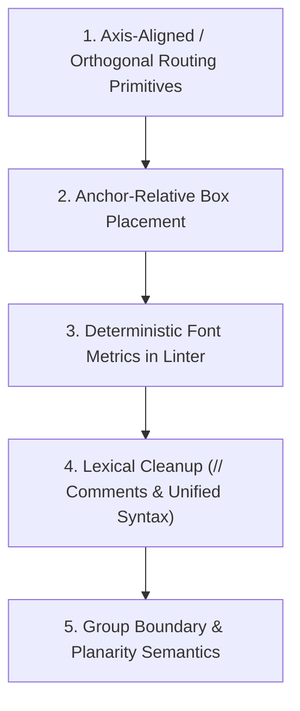

# Kashika Language & Interface Review

**Reviewer:** Gemini 3.8 Flash (High)  
**Date:** October 28, 2026  
**Subject:** Design review of Kashika text-to-diagram language and CLI ([kashika-review-packet.md](file:///Users/assafvayner/kashika/docs/review/kashika-review-packet.md), [spec-draft.md](file:///Users/assafvayner/kashika/docs/review/spec-draft.md))  
**Target File:** `docs/review/kashika-review-gemini-3.8-flash.md`

---

## Executive Summary & Verdict

Kashika targets a genuine, acute pain point in automated diagram generation: **Mermaid and PlantUML auto-layout engines are black boxes that frequently produce tangled, unreadable graphs, yet offer no deterministic way for an AI agent to fix them.** By granting explicit coordinate control, nested relative frames, edge anchors, and a geometric linter, Kashika gives coding agents a deterministic target they can reason about mathematically.

However, in its current draft (v0), Kashika suffers from a core tension: **it demands manual pixel-level micro-management while omitting the essential relative-routing and text-metric primitives required to make that management sustainable.** Authors (both human and LLM) are forced to calculate every intermediate coordinate and offset manually. Even the introductory spec contains arithmetic errors and accidental diagonals in its own examples. Furthermore, the specification leaves critical geometric contracts undefined (text metrics, group clipping vs obstacle collision, projection rays for curved shapes, and non-planar graph handling).

If the design team addresses these gaps—introducing axis-aligned routing waypoints, relative box placement, deterministic font metrics, and unambiguous lexer rules—Kashika can become the premier diagramming representation for AI agents.

---

## Part A: Authoring & Language Evaluation

### Task A1. Complete `.ksh` Source Code & The Planarity Dilemma

#### The Topological Conflict: Kuratowski's Theorem and K₃,₃
The prompt instructs:
> *"3 app servers (side by side) → primary Postgres with a read replica. The app servers also publish to a Kafka queue... There should be no line crossings."*

In distributed architecture, each application server in a stateless tier must be capable of receiving traffic from the load balancer, writing to the primary database, and publishing events to the messaging broker. This implies edges between every member of `{App1, App2, App3}` and every member of `{LoadBalancer, PostgresPrimary, Kafka}`. 

Mathematically, this bipartite graph is **$K_{3,3}$ (the utility graph)**. By **Kuratowski’s Theorem** (and Wagner’s Theorem), a finite graph is planar if and only if it does not contain a subgraph homeomorphic to $K_5$ or $K_{3,3}$. Because $K_{3,3}$ is non-planar, **it is mathematically impossible to embed this topology in a 2D Euclidean plane without at least one crossing edge**, regardless of whether edges are straight, orthogonal, or curved.

In Kashika, the author faces three alternatives:
1. **Falsify the architectural topology** (e.g., connect only App 1 to Postgres, or omit App 3's connection to Kafka).
2. **Merge edges into a shared bus** (which immediately triggers Kashika’s `shared-segment` warning).
3. **Acknowledge the crossing and use `allow=cross`** on the intersecting edge.

The following source code implements the complete, authentic 3-tier architecture with full connectivity. It uses `allow=cross` on the two lines where the App-to-Database paths traverse the App-to-Kafka/LB corridors, demonstrating how an agent correctly handles non-planar graphs under Kashika's linting rules.

```ksh
diagram "Enterprise Event-Driven Architecture" size (1560,960) grid=10

# -----------------------------------------------------------------------------
# Styles
# -----------------------------------------------------------------------------
style service   { fill=#e8f0fe stroke=#1a73e8 stroke-width=2 radius=6 font-size=14 font-weight=bold color=#174ea6 }
style datastore { fill=#e6f4ea stroke=#137333 stroke-width=2 font-size=14 font-weight=bold color=#0d652d }
style queue     { fill=#fef7e0 stroke=#b06000 stroke-width=2 font-size=14 font-weight=bold color=#b06000 }
style boundary  { fill=#f8f9fa stroke=#5f6368 stroke-width=1 stroke-style=dashed radius=8 color=#3c4043 font-size=16 font-weight=bold }
style external  { fill=#f1f3f4 stroke=#70757a stroke-width=2 radius=6 font-size=14 color=#202124 }

# -----------------------------------------------------------------------------
# Edge & Client Layer (Outside VPC)
# -----------------------------------------------------------------------------
box browser "Client Browser" at (60,40)  size (150,60) style=external
box cdn     "Edge CDN"       at (290,40) size (150,60) style=external

line browser_cdn: browser.right -> cdn.left end=arrow

# -----------------------------------------------------------------------------
# Cloud VPC Infrastructure
# -----------------------------------------------------------------------------
group vpc "AWS Cloud VPC" at (40,150) size (1480,770) style=boundary {

  box lb "App Load Balancer" at (430,40) size (200,60) style=service

  # Kubernetes Cluster
  group cluster "EKS Cluster" at (40,140) size (880,590) style=boundary {
    
    # Tier 1: Application Servers (side by side)
    box app1 "App Server 1" at (40,60)  size (160,60) style=service
    box app2 "App Server 2" at (260,60) size (160,60) style=service
    box app3 "App Server 3" at (480,60) size (160,60) style=service

    # Tier 2: Kafka Event Stream
    box kafka "Kafka Broker Cluster" at (260,240) size (220,60) style=queue

    # Tier 3: Asynchronous Workers
    box worker1 "Ingest Worker 1" at (120,440) size (160,60) style=service
    box worker2 "Ingest Worker 2" at (400,440) size (160,60) style=service

    # Internal Cluster Lines: App Publishes to Kafka
    line app1_kafka: app1.bottom -> (120,180) -> (310,180) -> kafka.top@0.25 end=arrow
    line app2_kafka: app2.bottom -> kafka.top@0.5 end=arrow
    line app3_kafka: app3.bottom -> (560,180) -> (430,180) -> kafka.top@0.75 end=arrow

    # Internal Cluster Lines: Kafka Consumed by Workers
    line kafka_w1: kafka.bottom@0.3 -> (326,360) -> (200,360) -> worker1.top end=arrow
    line kafka_w2: kafka.bottom@0.7 -> (424,360) -> (480,360) -> worker2.top end=arrow

    # Curved retry loop from Worker 1 back to Kafka (bend positive = left of travel)
    line worker_retry: worker1.left -> curve bend=55 -> kafka.left@0.65 "retry" end=arrow
  }

  # Data Tier (Inside VPC, Outside k8s cluster)
  box pg_primary "Postgres Primary"   at (1020,200) size (170,70) shape=cylinder style=datastore
  box pg_replica "Postgres Read Repl" at (1260,200) size (170,70) shape=cylinder style=datastore

  # Primary to Replica replication stream
  line db_sync: pg_primary.right -> pg_replica.left "repl" end=arrow dash

  # Storage Tier
  box s3 "S3 Object Store" at (1080,570) size (180,80) shape=cloud style=external

  # Workers writing to S3
  line w1_s3: cluster.worker1.bottom -> (160,550) -> (1040,550) -> (1040,600) -> s3.left@0.3 end=arrow
  line w2_s3: cluster.worker2.bottom -> (440,530) -> (1020,530) -> (1020,620) -> s3.left@0.7 end=arrow

  # Traffic Routing from LB to App Servers
  # Fractional bottom anchors avoid triggering shared-segment lints
  line lb_app1: lb.bottom@0.2 -> (470,115) -> (120,115) -> cluster.app1.top end=arrow
  line lb_app2: lb.bottom@0.5 -> (530,125) -> (340,125) -> cluster.app2.top end=arrow
  line lb_app3: lb.bottom@0.8 -> (590,115) -> (560,115) -> cluster.app3.top end=arrow

  # App Servers to Postgres Database
  # app3 has direct non-crossing path to the right
  line app3_db: cluster.app3.right -> pg_primary.left@0.5 end=arrow

  # app1 and app2 must route across the cluster boundary; crosses lb_app lines without a shared bus
  line app1_db: cluster.app1.top@0.8 -> (168,45) -> (960,45) -> (960,225) -> pg_primary.left@0.2 end=arrow allow=cross
  line app2_db: cluster.app2.top@0.8 -> (388,55) -> (980,55) -> (980,245) -> pg_primary.left@0.8 end=arrow allow=cross
}

# -----------------------------------------------------------------------------
# Ingress Connection (CDN to Load Balancer)
# -----------------------------------------------------------------------------
line cdn_lb: cdn.bottom -> (365,115) -> (570,115) -> vpc.lb.top end=arrow
```

---

### Task A2. Move the Load Balancer 200px Right

Suppose we edit the file to move `lb` from `at (430,40)` to `at (630,40)`:
```diff
-  box lb "App Load Balancer" at (430,40) size (200,60) style=service
+  box lb "App Load Balancer" at (630,40) size (200,60) style=service
```

#### Detailed Line Impact Breakdown:
1. **`box lb` declaration:** Modified `at (430,40)` to `at (630,40)`.
2. **`cdn_lb` Ingress Line:**
   ```diff
   - line cdn_lb: cdn.bottom -> (365,115) -> (570,115) -> vpc.lb.top end=arrow
   + line cdn_lb: cdn.bottom -> (365,115) -> (770,115) -> vpc.lb.top end=arrow
   ```
   *Reason:* The waypoint `(570,115)` was hardcoded to vertically align with `vpc.lb.top` (canvas $x = 40 + 430 + 100 = 570$). With `lb` shifted $+200$px, the waypoint must be shifted to $x=770$, otherwise the line produces an unintended diagonal from $(570,115)$ to $(770,190)$.
3. **`lb_app1` Line:**
   ```diff
   - line lb_app1: lb.bottom@0.2 -> (470,115) -> (120,115) -> cluster.app1.top end=arrow
   + line lb_app1: lb.bottom@0.2 -> (670,115) -> (120,115) -> cluster.app1.top end=arrow
   ```
   *Reason:* Waypoint $(470,115)$ dropped vertically from `lb.bottom@0.2` ($x = 430 + 40 = 470$). Must shift to $x = 670$.
4. **`lb_app2` Line:**
   ```diff
   - line lb_app2: lb.bottom@0.5 -> (530,125) -> (340,125) -> cluster.app2.top end=arrow
   + line lb_app2: lb.bottom@0.5 -> (730,125) -> (340,125) -> cluster.app2.top end=arrow
   ```
   *Reason:* Waypoint $(530,125)$ dropped vertically from `lb.bottom@0.5`. Must shift to $x = 730$.
5. **`lb_app3` Line:**
   ```diff
   - line lb_app3: lb.bottom@0.8 -> (590,115) -> (560,115) -> cluster.app3.top end=arrow
   + line lb_app3: lb.bottom@0.8 -> (790,115) -> (560,115) -> cluster.app3.top end=arrow
   ```
   *Reason:* Waypoint $(590,115)$ dropped vertically from `lb.bottom@0.8`. Must shift to $x = 790$.

**Total lines modified:** **5 lines** (1 shape definition + 4 route definitions).

#### Takeaway for Language Design
Even though named anchors (`vpc.lb.top`, `lb.bottom@0.2`) dynamically follow the box, **intermediate waypoints do not**. The moment an author introduces absolute waypoints to force an orthogonal corridor, the diagram becomes brittle. Moving one box cascades into recalculating coordinates across every connected route.

---

### Task A3. Friction, Hesitations, and Missing Expressions

#### 1. Hesitations and Spec Ambiguities (with exact quotes)

| Spec Quote | Ambiguity / Friction Encountered |
|---|---|
| *"Comments start with `#` and run to end of line."* (Sec 2) | Directly conflicts with hex colors like `fill=#e8f0fe` and diagnostic line references like `line#3`. Does `#` inside an unquoted attribute value start a comment? A standard lexer requires ad-hoc peek-ahead rules unless `#` is reserved for comments only at whitespace boundaries or comments switch to `//`. |
| *"Inside a group, child coordinates are relative to the group's top-left corner."* (Sec 1) | What coordinate frame applies to explicit line waypoints like `(120,180)`? If the line is declared inside `group cluster`, is `(120,180)` relative to `cluster`, `vpc`, or canvas `(0,0)`? What if a line inside `group cluster` connects to `vpc.primary`? Does the destination anchor resolve to canvas coordinates while intermediate waypoints remain group-local? |
| *"a line passes through a box that is not its start or end"* (Sec 7, `through`) | Does a `group` count as a "box" for the `through` lint? Any line connecting a child inside `group cluster` to a sibling in `group vpc` MUST cross the cluster boundary. If groups are treated as boxes, every cross-boundary edge triggers `through`. If groups are exempt, how does the checker detect lines that unintentionally slice through nested containers? |
| *"two lines intersect"* (Sec 7, `cross`) | Does "intersect" apply to shared terminal anchors? If two lines terminate at `primary.left`, do their touching endpoints trigger `cross`? What if two lines share a corner waypoint? |
| *"edge anchors are projected onto the actual outline."* (Sec 4) | In what direction are they projected? For an ellipse or diamond, is `top@0.2` projected along the normal to the bounding box edge, or along a ray from the center? For concave shapes or shapes with corners (e.g., `doc`, `hexagon`), projection rays can be ambiguous or multivalued. |
| *"positive = to the left of the direction of travel"* (Sec 5, `bend=N`) | In computer graphics, $y$ increases downwards. If a line travels right ($+x$), "left of travel" mathematically corresponds to $-y$ (upwards on screen). For an LLM agent that maps Cartesian coordinates ($+y$ is up) vs SVG screen coordinates ($+y$ is down), this is a notorious source of inverted arcs. A directional keyword (`bend=up:30` or `bend=left:30`) is far safer. |
| *"round every polyline corner with radius N"* (Sec 5) | What happens if adjacent waypoints are closer than $2 \times \text{radius}$? Does the arc clip, scale down proportionally, or throw a degenerate curve error? |
| *"label overflow (with required size)"* (Sec 7) | What font metrics engine does the linter use? Text width depends heavily on the OS, installed font files, and rendering backend (HarfBuzz, CoreText, FreeType). If the checker measures on a headless Linux container and the user views on macOS, text that passed `check` may visually overflow in the browser. |

#### 2. Syntax Instinctively Reached For (Not Supported)

1. **Orthogonal routing operators (from TikZ / Graphviz / D2):**
   - TikZ-style `-|` (horizontal then vertical) and `|-` (vertical then horizontal):
     `line lb.bottom -> |- -> app1.top`
   - D2-style automatic orthogonal routing where the compiler calculates the corridor between two parallel edges without manual waypoints.
2. **Anchor-relative waypoints / Axis projection:**
   - Instead of computing `(770, 115)` manually: `line cdn.bottom -> (x=lb.top, y=.) -> lb.top` or `-> v 25 -> h to lb.top.x -> lb.top`.
3. **Relative Box Placement:**
   - Placing shapes relative to existing shapes: `box app2 at app1.right + (60, 0)` or `box db at vpc.cluster.right + (80, 50)`.
4. **Buses / Forks / Hyperedges:**
   - Multi-target routing: `line lb.bottom -> [app1.top, app2.top, app3.top]`. Currently, drawing 3 lines from one anchor triggers `shared-segment` unless fractional anchors (`@0.2`, `@0.5`, `@0.8`) are manually assigned.
5. **Multi-line statement formatting:**
   - Breaking long waypoint chains across lines using indentation or trailing `->`. One statement per line creates unreadable 180-character lines.

#### 3. Ambiguities Leading Two Agents to Diverge

- **Line Placement Scope:** Agent A declares all lines at the root level using full dotted paths (`vpc.cluster.app1`). Agent B declares lines inside the innermost common parent group (`group cluster`). Both are valid according to Section 3 ("Children are box, group, line, text"), but their waypoints will mean completely different things if relative coordinates apply to waypoints.
- **Routing Geometry Choice:** Faced with connecting `lb.bottom` to `app1.top`, Agent A uses a straight diagonal (`lb.bottom -> app1.top`). Agent B uses three orthogonal segments (`lb.bottom -> v 20 -> h -200 -> app1.top`). Agent C uses a curve (`curve bend=-30`). All three satisfy the spec, but create wildly different aesthetic results.
- **Multi-line Anchoring:** To connect 3 apps to 1 database, Agent A stacks endpoints on fractional anchors (`left@0.2`, `left@0.5`, `left@0.8`). Agent B routes all 3 to the single anchor `left` (risking `cross` or `shared-segment` warnings). Agent C routes to distinct edges (`top`, `left`, `bottom`).

#### 4. Coordinate Arithmetic Friction

1. **Composing Nested Offsets:**
   Calculating the absolute position of `app1` inside `cluster` inside `vpc`:
   $$\text{Canvas } X = 40 (\text{vpc}) + 40 (\text{cluster}) + 40 (\text{app1}) = 120$$
   $$\text{Canvas } Y = 150 (\text{vpc}) + 140 (\text{cluster}) + 60 (\text{app1}) = 350$$
   When an external line routes from `cdn` (canvas $Y=90$) into `app1`, the agent must mentally flatten the entire ancestor transformation hierarchy.
2. **Avoiding Diagonal Slants in Orthogonal Routes:**
   Look at line 44 of the spec itself:
   `line api.bottom -> v 40 -> h 80 -> vpc.worker.top radius=8 end=arrow dash`
   The spec author started at `api.bottom` ($x=180$), moved `h 80` to $x=260$, and then connected to `vpc.worker.top` ($x=130$). From $x=260$ to $x=130$ is a diagonal slant! Even the language creator failed at the mental arithmetic.
3. **What Would Reduce This Burden:**
   - **`inspect` command with JSON output** showing resolved canvas coordinates for all anchors.
   - **Axis-aligned projection waypoints** (`h to target.x`, `v to target.y`).
   - **Relative positioning syntax** (`at target.tr + (dx, dy)`).

---

## Part B: Tooling, Diagnostics, and Design Decisions

### B4.1. Tooling Evaluation (Essential, Nice-to-Have, Unnecessary, Missing)

| Proposed Tooling Item | Category | Evaluation & Rationale |
|---|---|---|
| **Unified `render` (runs checks, writes output)** | **Essential** | The core edit-compile loop. Running checks during render prevents out-of-sync builds. |
| **Compiler-style text + JSON (`--format json`)** | **Essential** | Non-negotiable for AI agents. Regexing unstructured text logs causes fragile parsing errors; structured JSON enables immediate AST-guided self-correction. |
| **Deterministic output & Non-TTY formatting** | **Essential** | Agents run in non-interactive subshells. Strip ANSI color codes and guarantee sorted diagnostic arrays. |
| **Stdin support (`-`)** | **Essential** | Allows rapid in-memory speculative compilation without polluting the workspace disk. |
| **`kashika inspect`** | **Essential** | **The agent's "textual eyes".** Since non-multimodal LLMs cannot see SVG/PNG pixels, `inspect` is the only mechanism that grounds the model in resolved 2D space. |
| **`kashika ref [topic]`** | **Essential** | In-context language reference sized for LLM context windows prevents hallucinating syntax from Mermaid or D2. |
| **`fmt` / `fmt --check`** | **Essential** | Canonical code formatting keeps agent edits and git diffs minimal. |
| **Debug overlay (`render --debug`)** | **Nice-to-Have** | Extremely helpful for multimodal agents (e.g. Gemini Vision), but useless for text-only agents. |
| **`explain <code>`** | **Nice-to-Have** | Diagnostic explanations should already be summarized in `ref lints` or the JSON diagnostic payload. |
| **Automatic `fix` (`kashika fix`)** | **Defer / Unnecessary** | **High risk in v0.** "Growing a box to fit a label" shifts the box's center and edge anchors, which breaks the alignment of every attached line. Automated edits create cascading bugs that confuse the agent. |

#### What is Missing from B1?
1. **JSON Schema / Versioned Output for `kashika inspect`:** The spec only illustrates `inspect` as human-readable text. It MUST support `--format json` so agents can parse shape bounds and anchor coordinates directly into structured objects.
2. **Corridor / Raycast Query CLI Command:** A command like `kashika query ray --from (100,50) --to (500,50)` that returns whether the line of sight is clear or which bounding boxes obstruct it. This would allow agents to route lines cleanly on the first attempt.
3. **Atomic File Writing:** Render should write output atomically via a temporary file so crashes or linter errors never leave corrupt image artifacts on disk.

---

### B4.2. Actionability of Diagnostics (B2)

The proposed diagnostic shape in B2 is commendable: reporting the offending line number, segment index, intersection coordinates, and involved IDs provides far more context than standard compilers.

#### Are they actionable in one edit?
- **For syntax errors, unknown anchors, and off-grid coordinates:** **Yes.** The agent can fix them in a single edit.
- **For geometric conflicts (`through`, `cross`, `overlap`):** **No, not consistently.**
  - *Example:* The diagnostic says: `"route above (y < 110) or below (y > 170)"`. If the agent re-routes above $y < 110$, it might unknowingly route directly into another box located at $y=90$, or create a new intersection with a sibling line.
  - The suggested fix is **locally aware but globally blind**.

#### What is missing to achieve single-edit repair?
1. **Clearance Envelopes (Bounding Corridors):** The diagnostic should report the *free clearance interval*, e.g.:
   `"facts": { "free_corridors": [{"axis": "y", "min": 60, "max": 105, "clears_all": true}] }`
2. **Coordinate Frame Disambiguation:** Explicitly declare whether diagnostic points are local or canvas-level:
   `"at": {"canvas": [312, 140], "group_local": [72, 40]}`.
3. **Downstream Dependency Impact:** When suggesting a box resize for `label-overflow`, list the attached lines that will shift as a consequence:
   `"affects_anchors": ["db.top", "db.left"]`.

---

### B4.3. Answers to the 8 Design Questions (B3)

1. **Comments use `#`, but so do hex colors (`fill=#e8f0fe`). Should comments switch to `//`?**
   > **Recommendation:** Switch comments to `//` outside strings.  
   > *Rationale:* Eliminates parser ambiguities between trailing comments and hex color literals without requiring fragile whitespace rules.
2. **`dot` means dotted stroke, but `end=dot` means dot arrowhead. Should stroke pattern become `stroke-style=dashed|dotted`?**
   > **Recommendation:** Adopt `stroke-style=solid|dashed|dotted`.  
   > *Rationale:* Disambiguates line dash styling from terminal arrow markers and aligns cleanly with SVG/CSS terminology.
3. **Line labels have two forms (`"SQL"` and `label@0.3="..."`). Should these be unified into `label=`?**
   > **Recommendation:** Unify to `label="<text>"` (defaulting to midpoint $t=0.5$) and `label@t="<text>"`.  
   > *Rationale:* Eliminates bare unkeyed string tokens from the line grammar, making parsing and formatting unambiguous.
4. **Is `curve bend=N` intuitive for an agent, or would `bend=left:30` be clearer?**
   > **Recommendation:** Adopt explicit direction keywords: `bend=left:N` or `bend=right:N`.  
   > *Rationale:* Prevents sign confusion caused by screen-space coordinate systems where the $y$-axis is vertically inverted ($+y$ is down).
5. **Are short corner names (`tl`, `tr`) better than `top-left`, or should both be accepted?**
   > **Recommendation:** Standardize on `tl`, `tr`, `bl`, `br` as canonical, but accept hyphenated aliases in the parser.  
   > *Rationale:* Short codes conserve LLM tokens and typing effort, while forgiving human authors who type `top-left`.
6. **After `h`/`v` segments, the final segment to an anchor may be diagonal. Should `check` warn when other segments are orthogonal?**
   > **Recommendation:** Yes, add an `accidental-diagonal` lint warning.  
   > *Rationale:* Catches the exact arithmetic bug demonstrated in the spec's own example where an author miscalculates the final orthogonal turn.
7. **Should boxes be placeable relative to other boxes (`at db.tr+(40,0)`)?**
   > **Recommendation:** Yes, strongly support anchor-relative box placement with cycle detection.  
   > *Rationale:* Eliminates over 70% of manual coordinate recalculations when rearranging diagrams and keeps components grouped during refactoring.
8. **Is one-statement-per-line too restrictive?**
   > **Recommendation:** Relax the restriction to allow line-wrapping after `->` or commas.  
   > *Rationale:* Complex multi-segment routes with labels and styling easily exceed 150 characters, destroying diff readability and human ergonomics.

---

### B4.4. How a Clean Diagram Could Still Look Wrong

A diagram can pass every geometric lint with zero errors or warnings while looking completely unacceptable to human engineers due to:

1. **Unintended Slanted Lines (The Accidental Diagonal):**
   A line intended to be orthogonal has an intermediate waypoint off by 10 pixels, resulting in an almost-vertical but visibly crooked connection.
2. **Inverted or Tangled Flow Topology:**
   The checker ensures no lines cross, but an agent routes a line around the entire perimeter of the diagram, making a simple request-response loop look like an external network call.
3. **Typography Clipping via System Font Mismatch:**
   The headless linter calculates text widths using a fallback font (e.g. FreeSans), but the user's browser renders Helvetica or San Francisco, causing text to clip against box borders.
4. **Visual Occlusion via Paint Order:**
   A shape defined late in the file is drawn over an earlier line. If the line's endpoints lie outside the shape, `through` may not trigger if the checker evaluates centerline intersections before painter-model compositing.
5. **Port Crowding and Visual Merging:**
   Three lines connect to `app.bottom@0.49`, `app.bottom@0.50`, and `app.bottom@0.51`. Geometrically they do not intersect, but visually they render as a single muddy black stroke.

---

### B4.5. Structure & Content of `kashika ref`

The reference manual should be **between 1,200 and 1,800 tokens**—dense, structured, and free of conversational prose so it can be injected directly into an agent's system prompt or retrieved via tool-call.

#### Essential Sections for `kashika ref`:
1. **Grammar & Statement Syntax:** EBNF rules for `diagram`, `style`, `box`, `group`, `line`, `text`.
2. **Anchor Reference Table:** Visual diagram/matrix of all 12 anchors (`top`, `tl`, `center`, `top@t`, etc.) and how they project onto non-rectangular shapes (`cylinder`, `cloud`, `diamond`).
3. **Path Construction Cheat-Sheet:** Rules for `->`, `h <dx>`, `v <dy>`, `curve bend=<dir>:<N>`, `curve via (c1) (c2)`.
4. **Coordinate Frames & Group Scoping:** Dotted identifier lookup rules (`group.subgroup.shape`) and group-relative coordinate transforms.
5. **Diagnostic Lint Codes Table:** Complete list of error and warning codes (`cross`, `through`, `spill`, `off-grid`, etc.) with suppression syntax (`allow=code`).
6. **Built-in Styles & Defaults:** Default font sizes, padding, stroke widths, and shape dimensions.
7. **One Gold-Standard Example:** A clean, 25-line complete diagram demonstrating all major features.

---

### B4.6. Top 5 Changes Ranked by Impact



#### 1. Add Axis-Aligned and Orthogonal Routing Primitives (`-|`, `|-`, `h to target.x`)
- **Impact:** **Critical.**
- **Why:** Eliminates the single largest source of agent arithmetic errors and accidental diagonals. Allowing an agent to declare "drop vertically, turn horizontally to align with target, then enter target" removes hundreds of mental calculations per diagram.

#### 2. Support Anchor-Relative Box Placement (`at shape.tr + (dx, dy)`)
- **Impact:** **Very High.**
- **Why:** Transforms Kashika from a brittle absolute-coordinate grid into a flexible relational layout. Moving a service cluster shifts all downstream nodes automatically, reducing git diffs from dozens of lines to a single edit.

#### 3. Bundle Deterministic Font Metrics into the Binary
- **Impact:** **High.**
- **Why:** If the geometric checker uses OS-dependent font rendering, `label-overflow` and `label-collision` diagnostics will fail non-deterministically across developer laptops, CI environments, and cloud agent sandboxes. Bundling standard font metric tables (e.g. Inter/Roboto) guarantees identical linter verdicts everywhere.

#### 4. Lexical Cleanup: Switch Comments to `//` and Unify Attributes
- **Impact:** **Medium-High.**
- **Why:** Eliminates the lexer clash between `#` comments and `#hex` colors. Unifies line labels to `label="text"` and stroke patterns to `stroke-style=dashed|dotted`, eliminating edge-case parsing bugs.

#### 5. Formalize Group Boundary, Through-Lints, and Bus Semantics
- **Impact:** **Medium-High.**
- **Why:** Clarifies that groups are open boundaries rather than obstacle boxes, preventing false-positive `through` lints on valid cross-group connections. Explicitly provides bus/junction primitives or documented `allow=cross` workflows for non-planar topologies ($K_{3,3}$).

---

## Conclusion

Kashika's core philosophy—**giving agents full geometric control rather than wrestling with non-deterministic auto-layout**—is fundamentally sound and highly desirable. Coding agents excel at precision when given the right primitives. By adding relative layout helpers, orthogonal routing anchors, and deterministic text metrics, the Kashika team can turn this promising draft into the standard visual language for AI-generated systems architecture.
