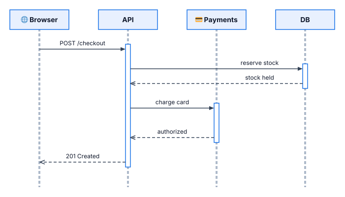
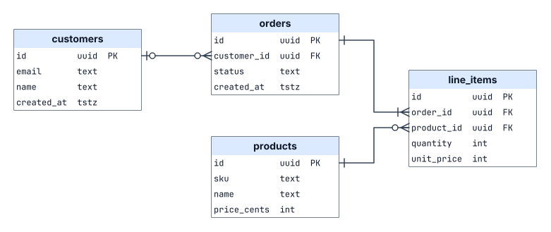
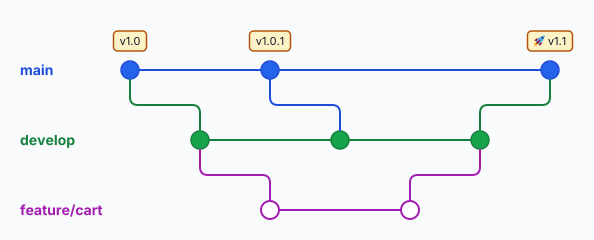
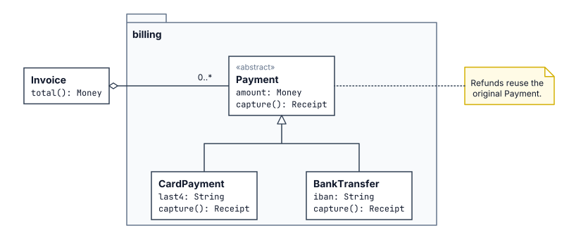
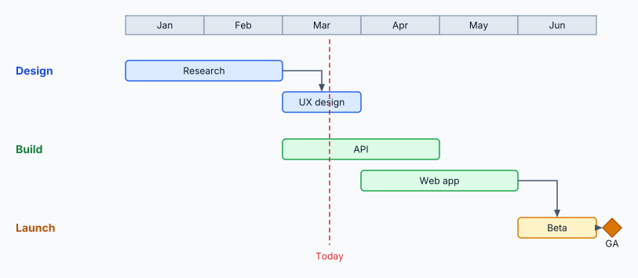

# Examples

Each example lives in its own directory with its source and committed renders.

## Regenerating the renders

Run from the repository root after changing an example, the renderer or the language:

```sh
cargo run -p kashika -- render examples/flowchart/flowchart.kash -o examples/flowchart/flowchart.svg
cargo run -p kashika -- render examples/flowchart/flowchart.kash -o examples/flowchart/flowchart.png
```

`render` refuses to write when the file has errors, and every example must also check with 0 warnings (`kashika check examples/<name>/<name>.kash`). `cargo test` fails if a committed `.svg` or `.png` is missing or doesn't match a fresh render, and its message names the command to run.

## upload

Upload path: a browser through a load balancer, two APIs, a queue, a worker and Postgres inside a VPC group that fits its children, with `arrow` statements and a fitted canvas.


## shapes

Order flow with a decision that takes both branches, above a fitted group showing all 17 built-in shapes in a grid placed with corner anchors (`tr`, `bl`) and a shared `style` with `size`.


## flowchart

Checkout decision flow: `stadium` terminals, diamonds for decisions, `hv`/`vh` elbows, yes/no labels beside the line with `label-side`, and junctions where branches merge.


## microservices

E-commerce backend: nested subnet groups in a VPC that fits them, bundled icons (`load-balancer`, `gateway`, `mobile`, `cache`), a cylinder database, a junction fan-out, and several paths taken verbatim from `kashika route`.


## state-machine

TCP connection lifecycle: curved transitions (`curve left/right` and `curve via`), a self-loop and labels placed with `label@t`.


## network

Office network: an imported shape library (`net.kash`) with namespaced names, a local SVG as a box's `icon=` above its label, an `image`, and a `label-side=right` label on a vertical link.


## data-pipeline

Analytics pipeline: sublabels, `{ }` text blocks, inline markup, `label-side=above` labels in narrow gaps, and a bypass line routed over the top row so nothing crosses.


## org-chart

Engineering org: a junction bus per level, a strict `grid=`, relative placement with `pin`, and a canvas that fits the chart.


## sequence

Checkout sequence diagram: participant headers from a `style` with `size`, dashed `layer=under` lifelines and activation bars, `label-side=above` requests, dashed replies with `open` ends, emoji in labels, and messages that skip a lifeline with `label@t`.



## er

Orders schema as table cards: `layer=under` outlines with header and row boxes, monospace columns, and crow's-foot ends (`zero-many`, `zero-one`, `one-many`, `one`), with two relationships leaving one card through a shared lane.



## git-graph

Release branches as a commit graph: guide junctions (no `dot`) for lanes and columns, commit styles with `shape=ellipse`, tag boxes with `padding=(6,3)`, `vhv` branch and merge edges with `radius=`, and a `background=` color.



## class-diagram

Billing classes in UML: a `package` shape as a `layer=under` backdrop, class boxes as text blocks, a `triangle` generalization through a junction, a `hollow-diamond` aggregation and a `note` attached with a dotted line.



## gantt

Roadmap with a month header and milestone guide junctions (no `dot`): bars sit on mixed points like `(m2.x, r3.y)` with widths that span whole months between guides, per-workstream styles, ortho dependency arrows between bars, a dashed "today" line and a milestone diamond.


