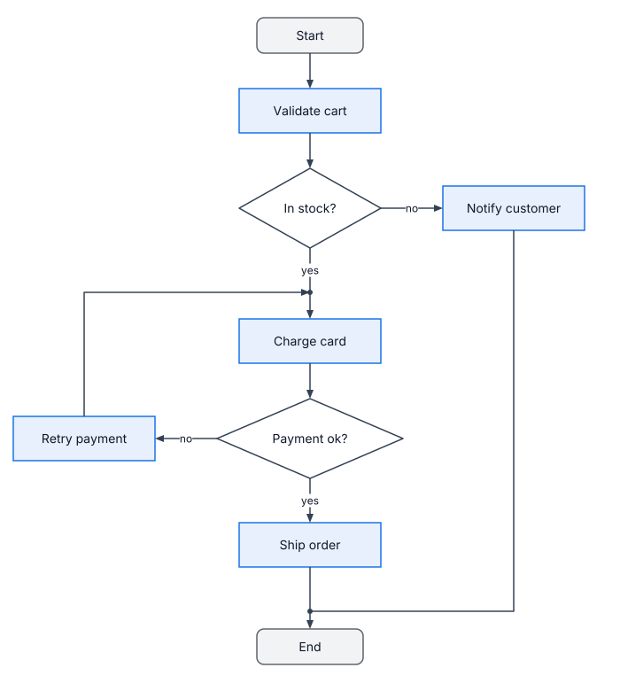
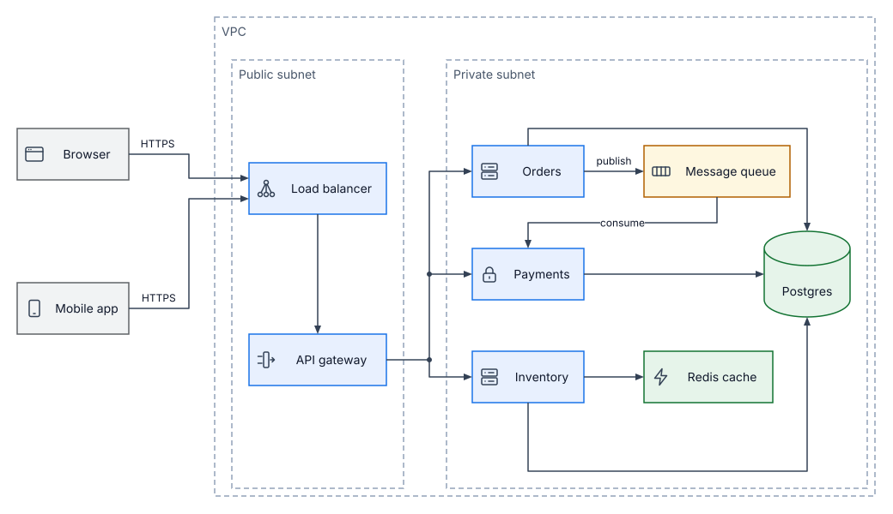
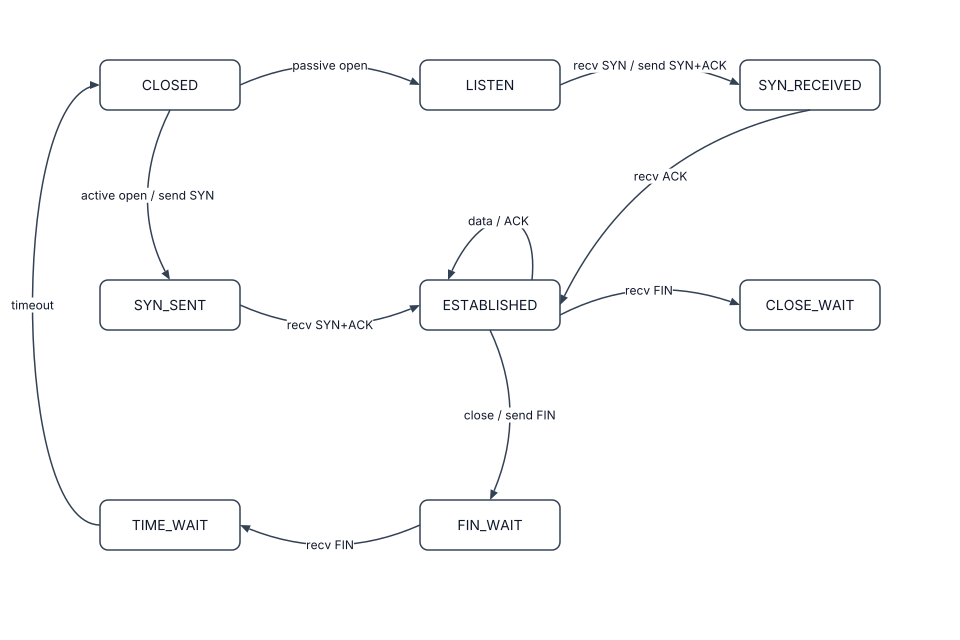
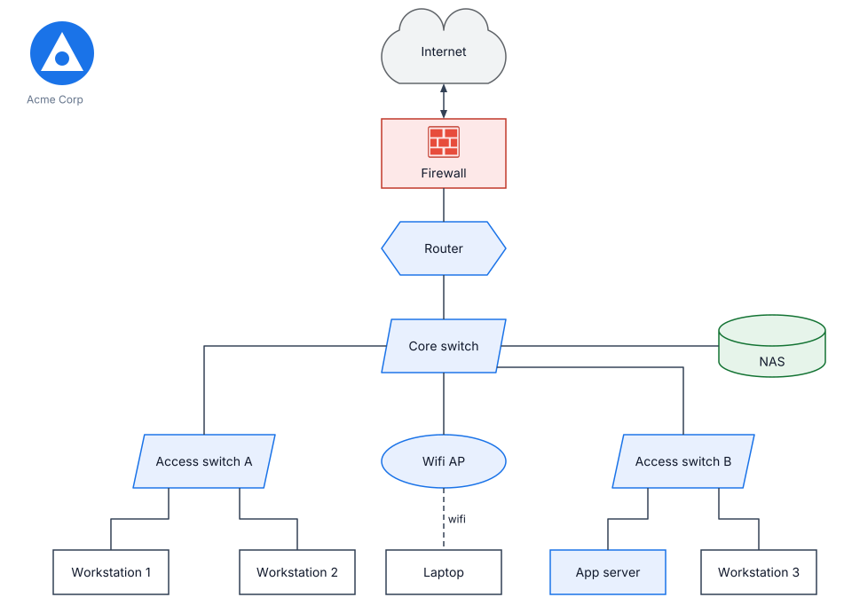
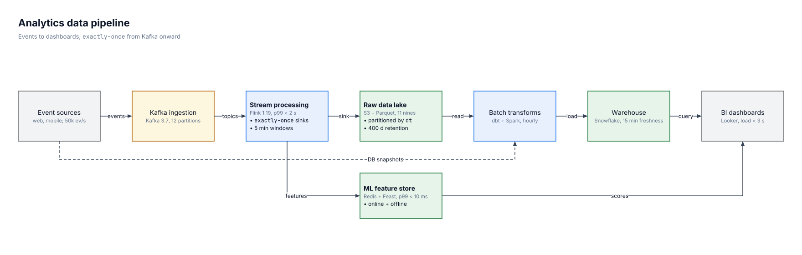
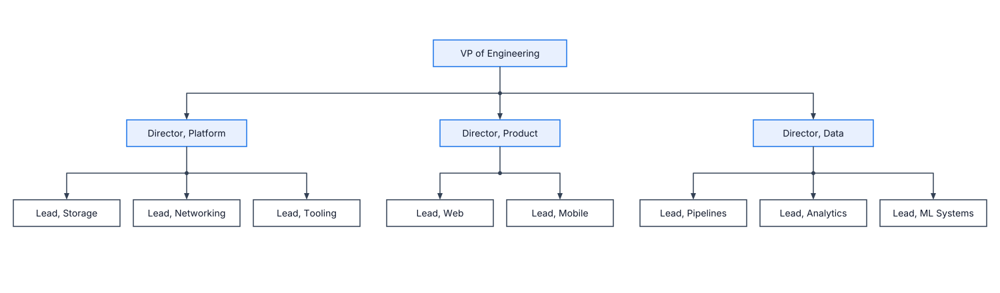

# Examples

Each example lives in its own directory with its source and committed renders.

## Regenerating the renders

Run from the repository root after changing an example, the renderer or the language:

```sh
cargo run -p kashika-cli -- render examples/flowchart/flowchart.kash -o examples/flowchart/flowchart.svg
cargo run -p kashika-cli -- render examples/flowchart/flowchart.kash -o examples/flowchart/flowchart.png
```

`render` refuses to write when the file has errors, and every example must also check with 0 warnings (`kashika check examples/<name>/<name>.kash`). `cargo test` fails if a committed `.svg` or `.png` is missing or doesn't match a fresh render, and its message names the command to run.

## upload

Upload path: a browser through a load balancer, two APIs, a queue, a worker and Postgres inside a VPC group.


## shapes

Order flow: person, rounded, diamond and cylinder shapes joined by labeled lines.


## flowchart

Checkout decision flow: diamonds for decisions, `hv`/`vh` elbows, yes/no labels and junctions where branches merge.



## microservices

E-commerce backend: nested VPC and subnet groups, bundled icons, a cylinder database, and several paths taken verbatim from `kashika route`.



## state-machine

TCP connection lifecycle: curved transitions (`curve left/right` and `curve via`), a self-loop and labels placed with `label@t`.



## network

Office network: an imported shape library (`net.kash`) with namespaced names, a `shape from` SVG, and an `image`.



## data-pipeline

Analytics pipeline: sublabels, `{ }` text blocks, inline markup, boxes sized with `kashika measure`, and one crossing kept on purpose with `allow=` and a `reason=`.



## org-chart

Engineering org: a junction bus per level, a strict `grid=`, and relative placement with `pin`, including `pin=<side>@t`.


