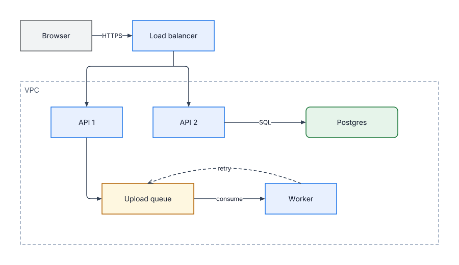
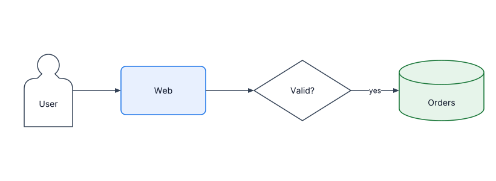

# Examples

Each example lives in its own directory with its source and committed renders.

## upload

Upload path: a browser through a load balancer, two APIs, a queue, a worker and Postgres inside a VPC group.

## shapes

Order flow: person, rounded, diamond and cylinder shapes joined by labeled lines.

